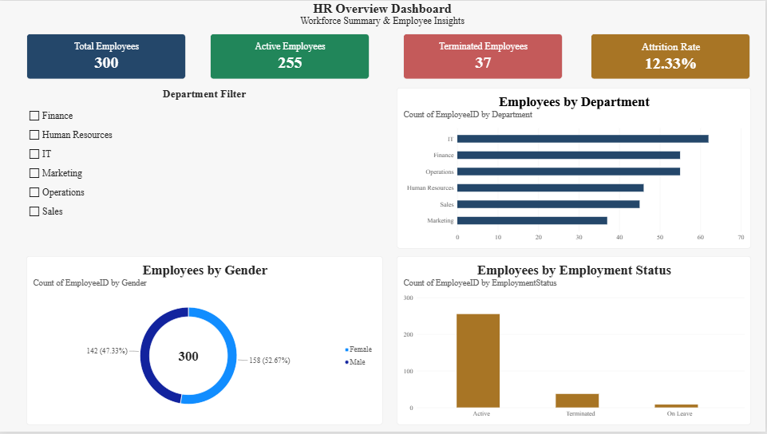
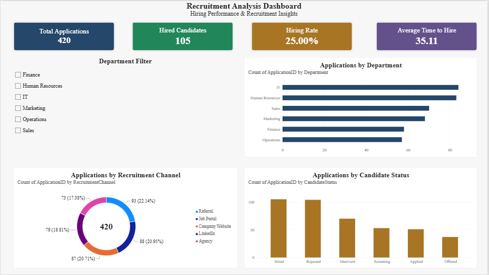
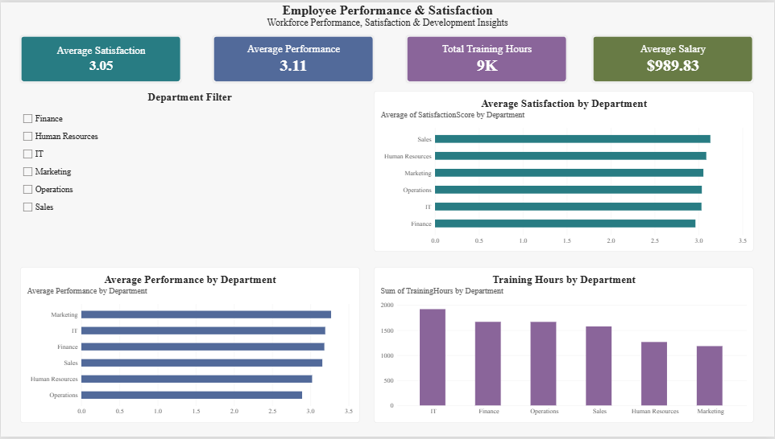

CodeAlpha HR Analytics Dashboard

Project Overview
The HR Analytics Dashboard is a Power BI project developed as part of the CodeAlpha Internship Program.
The purpose of this project is to analyze workforce information, employee performance, satisfaction, and recruitment activities through interactive dashboards and meaningful visualizations.

Tools & Technologies
 - Microsoft Power BI Desktop
 - Microsoft Excel
 - DAX (Data Analysis Expressions)
 - Data Visualization and Analytics

Dashboard Pages

1. HR Overview
Provides an overview of the organization’s workforce, including:
 - Total Employees
 - Active Employees
 - Terminated Employees
 - Attrition Rate
 - Employees by Department
 - Employees by Gender
 - Employees by Employment Status

2. Recruitment Analysis
Presents recruitment performance and hiring insights, including:
 - Total Applications
 - Hired Candidates
 - Hiring Rate
 - Average Time to Hire
 - Applications by Department
 - Applications by Recruitment Channel
 - Applications by Candidate Status

3. Employee Performance & Satisfaction
Analyzes employee performance, satisfaction, and development, including:
 - Average Satisfaction
 - Average Performance
 - Total Training Hours
 - Average Salary
 - Average Satisfaction by Department
 - Average Performance by Department
 - Training Hours by Department

Key Project Highlights
 - Interactive Department Filter slicers.
 - KPI cards for important HR metrics.
 - Interactive charts and visual reports.
 - Consistent dashboard design and color themes.
 - Data-driven insights into workforce and recruitment performance.

Dataset Information
This project uses fictional and synthetic employee and recruitment data created for educational and demonstration purposes.
 - 300 employee records.
 - 420 recruitment application records.

No real employee or confidential organizational data is used.

Repository Contents
 - CodeAlpha_HR_Analytics_Dashboard.pbix – Power BI dashboard file.
 - README.md – Project documentation.

Author
Ahmad Farhad Alami
GitHub: AhmadFarhadAlami (https://github.com/AhmadFarhadAlami)

Internship
CodeAlpha Internship Program
November 2026

## Dashboard Screenshots

### 1. HR Overview

### 2. Recruitment Analysis

### 3. Employee Performance & Satisfaction

,
